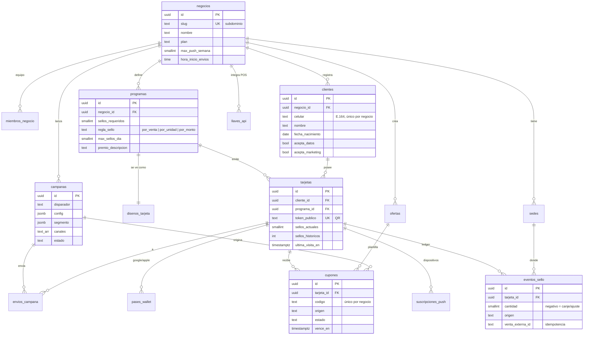

# Modelo de datos — Beely

Migración: `supabase/migrations/20261027000001_nucleo.sql` · Pruebas: `supabase/tests/0001_nucleo.sql` (recorrido) y `supabase/tests/0002_nucleo_aserciones.sql` (aserciones, corren en CI)

## Diagrama ER

## Tablas

| Tabla | Para qué | Escribe |
|-------|---------|---------|
| `administradores_plataforma` | Usuarios con control total de Beely | Manual / SQL |
| `negocios` | Cada empresa cliente de Beely (marca, plan, límites de envío) | Plataforma crea; dueño/admin editan columnas de marca |
| `miembros_negocio` | Equipo del negocio con rol | Dueño |
| `sedes` | Puntos de venta con coordenadas (para Wallet) | Plataforma crea; dueño/admin editan |
| `clientes` | Cliente final de un negocio + autorizaciones Ley 1581 | Edge Function `club-registro`; equipo solo marca `celular_verificado` |
| `programas` | Reglas de sellos y premio (uno activo por negocio) | Dueño/admin |
| `disenos_tarjeta` | Apariencia del pase y de la PWA; `version` sube → re-sincronizar Wallet | Dueño/admin |
| `tarjetas` | Tarjeta del cliente en un programa; contadores denormalizados | Solo funciones SQL |
| `eventos_sello` | Ledger inmutable de sellos (+venta, −premio, ±ajuste) | Solo `registrar_sello()` |
| `ofertas` | Plantillas de descuento | Dueño/admin |
| `cupones` | Cupones emitidos a una tarjeta | Funciones SQL / Edge Functions |
| `campanas` | Configuración de campañas y disparadores | Dueño/admin |
| `envios_campana` | Registro de cada envío; base del tope semanal | Motor de campañas |
| `suscripciones_push` | Endpoints Web Push por dispositivo | `club-push-suscribir` |
| `pases_wallet` | Pase emitido en Google/Apple por tarjeta | `wallet-google` / `wallet-apple` |
| `llaves_api` | Llaves del POS (solo hash) | `llaves-api` |

## Funciones de negocio

### `registrar_sello(negocio_id, token_tarjeta, venta_externa_id, sede_id?, monto_venta?, unidades?, origen?, creado_por?) → jsonb`

1. Si `venta_externa_id` ya existe para el negocio → `{ duplicado: true }` sin sumar.
2. Bloquea la tarjeta (`for update`) para evitar carreras entre cajas.
3. Calcula sellos según `regla_sello` y recorta por `max_sellos_dia` (zona del negocio).
4. Inserta en `eventos_sello`; si completa la tarjeta emite cupón `premio_sellos` y registra el descuento de sellos.
5. Devuelve `sellos_sumados`, `sellos_actuales`, `premio_emitido` y el cupón si aplica.

Errores: `tarjeta_no_encontrada`, `tarjeta_bloqueada`, `programa_inactivo`, `origen_invalido`.

### `canjear_cupon(negocio_id, codigo, venta_externa_id?, sede_id?, canjeado_por?) → jsonb`

Canjea un cupón emitido y vigente. Repetir con la misma venta devuelve `{ duplicado: true }`.

Errores: `cupon_no_encontrado`, `cupon_ya_canjeado`, `cupon_no_disponible`, `cupon_vencido`.

Ambas solo se pueden ejecutar con `service_role`.

## Checklist de pruebas (verificado en Postgres 16 y en Supabase local con Postgres 17)

- [x] Sello normal suma 1
- [x] Misma `venta_externa_id` no suma dos veces
- [x] Tope diario de 3 sellos se respeta
- [x] Token de otro negocio es rechazado
- [x] Al completar 10 sellos se emite el premio y la tarjeta vuelve a 0
- [x] Canje funciona; repetir con la misma venta es idempotente; otra venta es rechazada
- [x] Cajero de A solo ve datos de A
- [x] Cajero no puede crear sedes, insertar sellos directo ni llamar `registrar_sello`
- [x] Cajero no puede editar fecha de nacimiento; sí puede marcar celular verificado
- [x] Administrador no puede cambiar el plan del negocio
- [x] Usuario sin negocio y `anon` no ven nada
