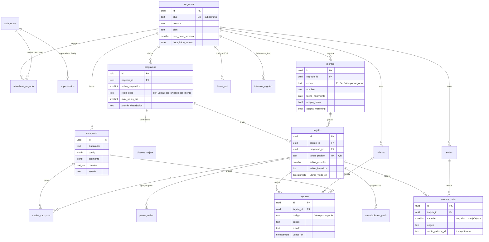

# Modelo de datos — Beely

Migraciones: `supabase/migrations/20261027000001_nucleo.sql` (núcleo), `20261027000002_panel.sql` (Sprint 1, panel) y `20261027000005_club.sql` (Sprint 2, club) · Pruebas: `supabase/tests/0001_nucleo.sql` (recorrido), `0002_nucleo_aserciones.sql` y `0003_panel_aserciones.sql` (aserciones, corren en CI)

El Sprint 1 no agrega tablas: agrega funciones, políticas y validaciones sobre las del núcleo.

## Diagrama ER

## Tablas

| Tabla | Para qué | Escribe |
|-------|---------|---------|
| `superadmins` | Usuarios con control total de Beely | Superadmin desde el panel (`superadmin_agregar` / `superadmin_quitar`) o SQL para el primero |
| `negocios` | Cada empresa cliente de Beely (marca, plan, límites de envío) | Superadmin crea; dueño/admin editan columnas de marca |
| `miembros_negocio` | Equipo del negocio con rol | Dueño (administradores y cajeros) · Superadmin (dueños) · Edge Function `panel-equipo` |
| `sedes` | Puntos de venta con coordenadas (para Wallet) | Superadmin crea; dueño/admin editan |
| `clientes` | Cliente final de un negocio + autorizaciones Ley 1581 | Edge Function `club-registro`; equipo solo marca `celular_verificado` |
| `programas` | Reglas de sellos y premio (uno activo por negocio) | `crear_negocio()` crea el primero; dueño/admin editan |
| `disenos_tarjeta` | Apariencia del pase y de la PWA; `version` sube → re-sincronizar Wallet | Dueño/admin |
| `tarjetas` | Tarjeta del cliente en un programa; contadores denormalizados | Solo funciones SQL |
| `eventos_sello` | Ledger inmutable de sellos (+venta, −premio, ±ajuste) | Solo `registrar_sello()` |
| `ofertas` | Plantillas de descuento | Dueño/admin |
| `cupones` | Cupones emitidos a una tarjeta | Funciones SQL / Edge Functions |
| `campanas` | Configuración de campañas y disparadores | Dueño/admin |
| `envios_campana` | Registro de cada envío; base del tope semanal | Motor de campañas |
| `suscripciones_push` | Endpoints Web Push por dispositivo | `club-push-suscribir` |
| `pases_wallet` | Pase emitido en Google/Apple por tarjeta | `wallet-google` / `wallet-apple` |
| `llaves_api` | Llaves del POS (solo hash) | `llaves-api` |
| `intentos_registro` | Intentos de registro de la última hora (huellas SHA-256 de IP y celular) | Solo `club_registrar()` |

## Funciones de negocio

### `registrar_sello(negocio_id, token_tarjeta, venta_externa_id, sede_id?, monto_venta?, unidades?, origen?, creado_por?) → jsonb`

1. Si `venta_externa_id` ya existe para el negocio → `{ duplicado: true }` sin sumar.
2. Bloquea la tarjeta (`for update`) para evitar carreras entre cajas.
3. Calcula sellos según `regla_sello` y recorta por `max_sellos_dia` (zona del negocio).
4. Inserta en `eventos_sello`; si completa la tarjeta emite cupón `premio_sellos` y registra el descuento de sellos.
5. Devuelve `sellos_sumados`, `sellos_actuales`, `premio_emitido` y el cupón si aplica.

Desde la migración 0002 también valida que el negocio esté `activo` y que la sede (si viene) sea del negocio y esté activa. Si no suma nada devuelve `motivo: sin_sellos_aplicables` y `detalle`: `tope_diario` (ya llegó a `max_sellos_dia`) o `compra_no_aplica` (monto bajo el mínimo).

Errores: `tarjeta_no_encontrada`, `tarjeta_bloqueada`, `programa_inactivo`, `origen_invalido`, `negocio_inactivo`, `sede_no_encontrada`.

### `canjear_cupon(negocio_id, codigo, venta_externa_id?, sede_id?, canjeado_por?) → jsonb`

Canjea un cupón emitido y vigente. Repetir con la misma venta devuelve `{ duplicado: true }`.

Errores: `cupon_no_encontrado`, `cupon_ya_canjeado`, `cupon_no_disponible`, `cupon_vencido`.

Ambas solo se pueden ejecutar con `service_role`.

### Funciones del panel (migración 0002)

| Función | Quién | Hace | Errores |
|--------|-------|------|---------|
| `crear_negocio(slug, nombre, zona_horaria?) → uuid` | Superadmin | Crea el negocio con su programa de sellos y diseño de tarjeta por defecto | `sin_permiso`, `slug_en_uso`, `zona_horaria_invalida` |
| `superadmin_actualizar_negocio(negocio_id, plan, estado)` | Superadmin | Cambia plan y estado (columnas que el negocio no puede tocar) | `sin_permiso`, `negocio_no_encontrado` |
| `equipo_negocio(negocio_id) → table` | Dueño / administrador | Equipo con correo, rol, último ingreso e invitación pendiente | `sin_permiso` |
| `usuario_por_email(email) → uuid` | Solo `service_role` | La usa `panel-equipo` para no reinvitar a quien ya tiene cuenta | — |

Logo propio (marca blanca, migración `0004_logos`): bucket público de Storage `logos`, ruta `{negocio_id}/logo-{marca de tiempo}.{png|jpg|webp}`, hasta 2 MB y sin SVG. Solo dueño, administrador o superadmin del negocio escriben en su carpeta (`privado.negocio_de_ruta(name)` + `privado.tiene_rol`). La URL pública queda en `negocios.logo_url` (check `negocios_logo_url_https`). Panel y club lo muestran con `LogoNegocio` de `packages/ui`.

Trigger `negocios_zona_horaria`: rechaza zonas horarias que Postgres no conoce (`zona_horaria_invalida`), porque el tope diario de sellos se calcula con ellas.

### Reglas de equipo (RLS de `miembros_negocio`)

- El dueño invita, cambia de rol y quita **administradores y cajeros**; no puede crear dueños, ascender a dueño ni tocar su propia fila.
- Solo el superadmin asigna o quita dueños.
- El administrador ve el equipo pero no lo gestiona; el cajero no lo ve.
- Del equipo solo se puede actualizar la columna `rol`.

### Club (migración 0005)

| Función | Quién | Hace |
|--------|-------|------|
| `club_registrar(slug, celular, nombre, fecha_nacimiento, acepta_marketing, huella_ip) → jsonb` | Solo `service_role` (`club-registro`) | Crea cliente + tarjeta con límite de intentos; `{registrado, token}` o `{registrado:false, motivo}` |
| `privado.tarjeta_club()`, `cliente_club()`, `negocio_club()` | Políticas de `anon` | Resuelven las cabeceras `x-tarjeta-token` / `x-negocio-slug` |

RLS de `anon` (la PWA): ve el negocio del slug o del token, su programa activo, diseño y sedes activas; con token, solo su tarjeta, cliente (nombre), cupones y sellos; escribe `clientes.acepta_marketing` y su `suscripciones_push`. Detalle en [sprint-2.md](sprint-2.md).

### Panel del superadmin (migración 0006)

| Función | Quién | Hace | Errores |
|--------|-------|------|---------|
| `superadmin_tablero(dias = 30) → jsonb` | Superadmin | Totales de la plataforma (negocios por estado y plan, clientes, sellos, cupones) y serie diaria de sellos y clientes nuevos, con días cortados en hora de Colombia | `sin_permiso`, `solicitud_invalida` |
| `superadmin_negocios(dias = 30) → setof` | Superadmin | Cada negocio con sedes, miembros, correo del dueño, clientes, sellos y canjes de la ventana y último sello | `sin_permiso`, `solicitud_invalida` |
| `superadmin_eliminar_negocio(negocio_id, confirmacion)` | Superadmin | Borra el negocio y todo lo suyo; exige el subdominio exacto. El panel borra antes su carpeta de `logos` | `sin_permiso`, `negocio_no_encontrado`, `confirmacion_incorrecta` |
| `superadmin_equipo(busqueda?) → setof` | Superadmin | Lista superadmins con correo y último ingreso | `sin_permiso` |
| `superadmin_agregar(email) → uuid` | Superadmin | Hace superadmin a una cuenta existente | `sin_permiso`, `usuario_no_encontrado`, `ya_es_superadmin` |
| `superadmin_quitar(usuario_id)` | Superadmin | Quita a otro superadmin; nadie se quita a sí mismo, así siempre queda uno | `sin_permiso`, `no_puedes_quitarte`, `usuario_no_encontrado` |

"Sellos" en las métricas son los de venta (`origen in ('api_pos', 'panel')`, cantidad positiva); no cuentan ajustes ni el descuento al emitir premio. El panel de plataforma vive en `/superadmin` (tablero), `/superadmin/negocios`, `/superadmin/negocios/:id` y `/superadmin/equipo`.

## Checklist de pruebas (Supabase local con Postgres 17)

### Núcleo (`0002_nucleo_aserciones.sql`)

- [x] Sello normal suma 1
- [x] Misma `venta_externa_id` no suma dos veces
- [x] Tope diario de 3 sellos se respeta
- [x] Token de otro negocio es rechazado
- [x] Al completar 10 sellos se emite el premio y la tarjeta vuelve a 0
- [x] Canje funciona; repetir con la misma venta es idempotente; otra venta es rechazada
- [x] Cajero de A solo ve datos de A
- [x] Cajero no puede crear sedes, insertar sellos directo ni llamar `registrar_sello`
- [x] Cajero no puede editar fecha de nacimiento; sí puede marcar celular verificado
- [x] Administrador no puede cambiar el plan del negocio
- [x] Usuario sin negocio y `anon` no ven nada

### Sprint 1 (`0003_panel_aserciones.sql`)

- [x] Superadmin crea negocio con programa activo y diseño; slug repetido y zona horaria inválida fallan
- [x] Superadmin crea sedes, asigna dueños y cambia plan
- [x] Dueño agrega administradores y cajeros y cambia su rol; no crea ni asciende dueños, no toca otro negocio, no cambia la llave de un miembro, no se borra a sí mismo
- [x] Dueño y administrador ven el equipo con correo; cajero y otros negocios reciben `sin_permiso`
- [x] Dueño no crea negocios ni cambia su plan; `usuario_por_email` es solo de `service_role`
- [x] Dueño edita marca y programa; zona horaria inválida falla al editar
- [x] Cajero no gestiona equipo, no edita programa ni sedes y solo ve las sedes de su negocio
- [x] Administrador edita sedes pero no quita cajeros
- [x] Sello desde el panel guarda origen `panel`, sede y cajero
- [x] Sede de otro negocio o inactiva → `sede_no_encontrada`; negocio suspendido → `negocio_inactivo`; la venta repetida sigue siendo idempotente
- [x] `detalle` distingue `compra_no_aplica` (monto bajo el mínimo) de `tope_diario`

### Logos (`0005_logos_aserciones.sql`)

- [x] Bucket `logos` público, de 2 MB y sin SVG; `negocio_de_ruta` solo acepta carpetas con uuid
- [x] Dueño sube, lista y borra el logo de su negocio y guarda `logo_url`; `logo_url` que no sea http(s) falla
- [x] Dueño no sube en la carpeta de otro negocio ni fuera de una carpeta de negocio
- [x] Cajero no sube ni borra logos; el dueño de otro negocio no lista ni borra logos ajenos

### Sprint 2 (`0006_club_aserciones.sql`)

- [x] anon sin cabeceras no ve nada; el slug muestra solo su negocio, programa activo, diseño y sedes activas
- [x] El token muestra solo su tarjeta, cliente, cupones y sellos; nunca celular, nacimiento, montos ni ids de venta
- [x] anon solo cambia `acepta_marketing` de su cliente y su suscripción push
- [x] `club_registrar`: solo service_role, celular repetido no entrega tarjeta, único por negocio, topes por IP y celular
- [x] El panel no cambia con las cabeceras

### Panel del superadmin (`0007_superadmin_panel_aserciones.sql`)

- [x] `superadmin_negocios` cuenta clientes, sedes, equipo y dueño; los sellos del periodo excluyen canjes, ajustes y lo que queda fuera de la ventana
- [x] `superadmin_tablero` suma lo mismo que la serie diaria y trae un punto por día
- [x] Agregar superadmin exige cuenta existente y no duplica; nadie se quita a sí mismo
- [x] Dueño y anon no llaman ninguna de estas funciones
- [x] Eliminar exige el subdominio y borra clientes, tarjetas y equipo del negocio sin tocar los demás
